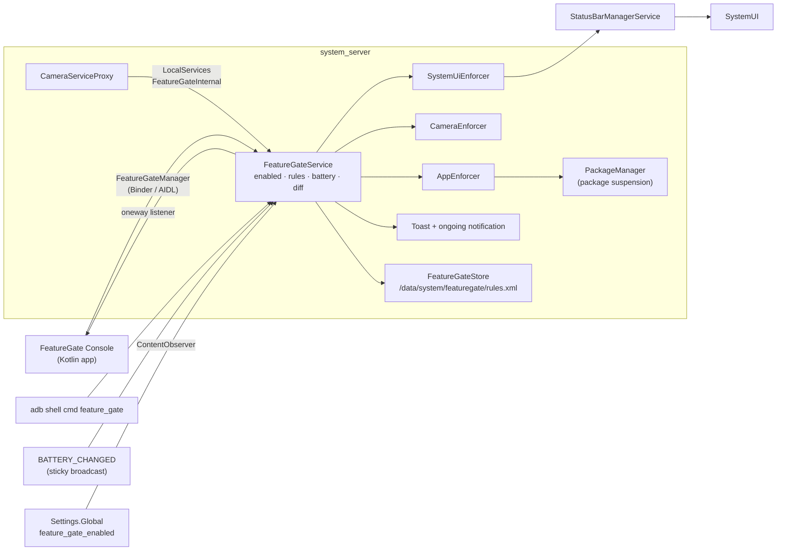

# FeatureGate

A battery-aware **feature-gating system service** for AOSP. It blocks device features (camera, navigation buttons, notification shade, specific apps) when the battery is below a configured level, and enforces those decisions inside the platform: in SystemUI, in the camera stack, in PackageManager, and through user-visible feedback.

Built from scratch on **AOSP android-15.0.0_r36**, tested on a **Pixel 9 Pro** (`aosp_caiman-userdebug`).

<!-- Add a short demo here: adb shell screenrecord /sdcard/demo.mp4, convert to GIF, put it in docs/images/ -->
<!--  -->

## What it does

- A rule says: *feature X is allowed only when the battery is at least N%, optionally always allowed while charging*.
- The service listens to battery changes and re-evaluates every rule.
- When a feature changes state, **enforcers** apply it:
  - **Navigation & notification shade**: hidden through `StatusBarManagerService` disable flags (survives a SystemUI restart)
  - **Camera**: opening the camera fails via a hook in `CameraServiceProxy`
  - **Apps** (`app:<package>` rules): the app is **suspended** through PackageManager (greyed icon, explanation dialog, data kept)
- The user sees why: a rate-limited **toast** when they hit a block, and an ongoing **notification** listing what's restricted.
- Rules are **saved** (AtomicFile, binary XML) and **restored at boot**, before the service accepts calls.
- The whole service can be switched **on or off** with a persistent setting (**off by default**). When off, it is dormant: nothing is enforced, changes are refused, and saved rules are kept.
- Apps observe changes through a **listener API**; changes require a **signature|privileged permission**, and only the admin console and the shell can even look the service up (SELinux).

## Architecture



## Platform concepts it exercises

| Area | Where in FeatureGate |
|---|---|
| Binder & AIDL | `IFeatureGateManager`, `oneway IFeatureGateListener`, hand-written `Parcelable`, `ServiceSpecificException` error codes mapped to Java exceptions in the manager |
| System service lifecycle | `SystemService`, `publishBinderService` / `publishLocalService`, boot phases (rules loaded in `onStart`, setting + battery at phase 500, notification + app reconciliation at boot completed) |
| Threading | Own `ServiceThread`, `IoThread` for disk writes, a leaf lock, no calls into other components under the lock, thread confinement |
| Client API | `FeatureGateManager` in `SystemServiceRegistry`, executor-based listeners, `RemoteCallbackList` death cleanup |
| Security | `MANAGE_FEATURE_GATES` (signature\|privileged), `clearCallingIdentity`, SELinux service type, lookup restricted to its real clients, `neverallow` for third-party apps |
| Settings | `Settings.Global` switch, `ContentObserver`, persisted by SettingsProvider, protected by `WRITE_SECURE_SETTINGS` |
| SystemUI integration | `IStatusBarService.disable/disable2` with a per-client token |
| Camera | Preventive check in `CameraServiceProxy.isCameraDisabled` |
| PackageManager | `setPackagesSuspended` with a dialog, per-suspender records, reconciliation at boot |
| Notifications | Low-importance ongoing notification for all users, updated in place |
| Persistence | `AtomicFile`, ABX binary XML, versioned format, debounced writes, safe loading of missing/corrupt files |
| Debuggability | `dumpsys feature_gate`, `cmd feature_gate` shell commands |

## SELinux policy

| File | Change |
|---|---|
| `system/sepolicy/private/service.te` | `type feature_gate_service, system_server_service, service_manager_type;` |
| `system/sepolicy/private/service_contexts` | `feature_gate  u:object_r:feature_gate_service:s0` |
| `system/sepolicy/private/feature_gate.te` | Lookup allowed only for `platform_app` (the shell is already covered by `shell.te`); `neverallow` so third-party apps can never be granted access ([file](src/system/sepolicy/private/feature_gate.te)) |

## Repository layout

```
patches/            git format-patch series, one commit per step, per AOSP project
  frameworks_base/
  system_sepolicy/
  build_soong/
src/                snapshot of the new source files, at their AOSP paths (for easy reading)
app/                FeatureGate Console test app (Kotlin)
scripts/            export (maintainer) and apply (reader) scripts
```

## Build & try it

```bash
# In an android-15.0.0_r36 tree
./scripts/apply-patches.sh /path/to/aosp
cd /path/to/aosp && source build/envsetup.sh && lunch aosp_caiman-trunk_staging-userdebug
m && adb reboot bootloader && fastboot flashall

adb root
adb shell settings put global feature_gate_enabled 1     # FeatureGate is off by default
adb shell dumpsys battery unplug && adb shell dumpsys battery set level 30
adb shell cmd feature_gate set-rule nav_back 50 false     # Back button disappears
adb shell cmd feature_gate set-rule camera 50 false       # camera open fails, toast shown
adb shell cmd feature_gate set-rule app:com.android.deskclock 50 false   # Clock app suspended
adb shell dumpsys feature_gate
adb shell settings put global feature_gate_enabled 0     # everything lifts, rules are kept
adb shell dumpsys battery reset
```

## Design decisions

- **Dormant, not stopped, when switched off**: system services can't be stopped at runtime and binders can't be unregistered, so when off the service enforces nothing, refuses changes, and keeps rules for when it's switched back on.
- **Fail-open on a corrupt rules file**: a bad file must never boot-loop system_server or leave a user without Back/Home.
- **Rules in `/data/system` (device-encrypted)**: available before the user unlocks, so rules apply right after boot.
- **Enforcers behind one interface**: each domain (SystemUI, camera, apps) is a separate class; the core service only computes state.
- **Diff-based enforcement with reconciliation**: enforcers only receive changes; app suspension, which PackageManager persists across reboots, is reconciled once at boot.
- **Defence in depth**: SELinux decides who can reach the service, a permission decides who can change rules, and Binder's kernel-stamped UID identifies the caller.

## Bugs found and fixed along the way

- **Rules written to the wrong storage**: the first version wrote to `/data/system_ce`, which only holds per-user folders and is locked until unlock; moved to `/data/system`.
- **`Boolean.getBoolean` instead of `parseBoolean`**: read a system property instead of parsing the argument, so `allowWhenCharging` was always false; caught by comparing `dumpsys` with the saved file.
- **Every suspension logged as a refusal**: `failed != null || failed.length > 0` short-circuits on an empty array; caught by comparing `dumpsys package` with the service's own log.
- **Boot loop after enabling the switch**: the settings handler ran the notify path directly on system_server's main thread during boot phase 500 and unboxed a null `Boolean`; because the setting was persisted, every boot crashed the same way. Fixed by posting to the service thread and using a primitive.

## Status

Personal learning project, built step by step. See the commit history in `patches/` for how it grew.

Planned: an on/off switch in the Settings app, Perfetto trace sections and boot-cost measurement, Battery Saver as a condition, unit tests.

## License

Apache License 2.0, the same as AOSP. See [LICENSE](LICENSE).
