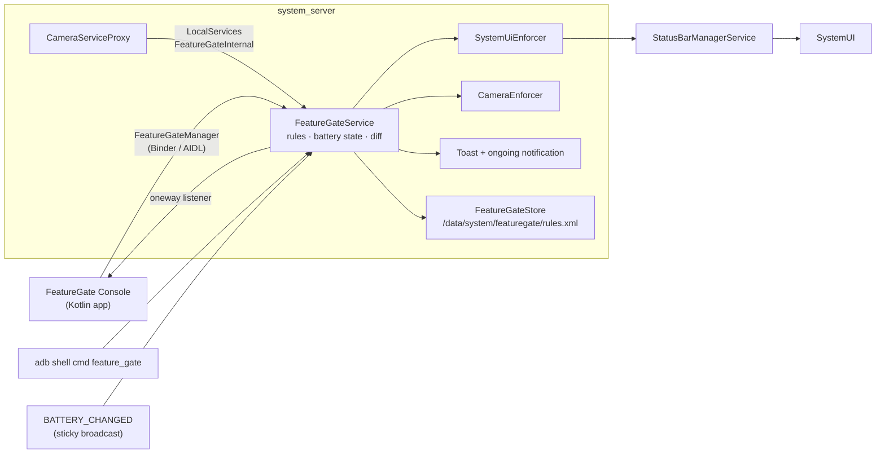

# FeatureGate

A battery-aware **feature-gating system service** for AOSP. It blocks device features (camera, navigation buttons, notification shade, specific apps) when the battery is below a configured level, and enforces those decisions inside the platform: in SystemUI, in the camera stack, and through user-visible feedback.

Built from scratch on **AOSP android-15.0.0_r36**, tested on a **Pixel 9 Pro** (`aosp_caiman-userdebug`).

<!-- Add a short demo here: adb shell screenrecord /sdcard/demo.mp4, convert to GIF, put it in docs/images/ -->
<!--  -->

## What it does

- A rule says: *feature X is allowed only when the battery is at least N%, optionally always allowed while charging*.
- The service listens to battery changes and re-evaluates every rule.
- When a feature changes state, **enforcers** apply it:
  - **Navigation & notification shade**: hidden through `StatusBarManagerService` disable flags (survives a SystemUI restart)
  - **Camera**: opening the camera fails via a hook in `CameraServiceProxy`
- The user sees why: a rate-limited **toast** when they hit a block, and an ongoing **notification** listing what's restricted.
- Rules are **saved** (AtomicFile, binary XML) and **restored at boot**, before the service accepts calls.
- Apps observe changes through a **listener API**; changes require a **signature|privileged permission**.

## Architecture



## Platform concepts it exercises

| Area | Where in FeatureGate |
|---|---|
| Binder & AIDL | `IFeatureGateManager`, `oneway IFeatureGateListener`, hand-written `Parcelable`, `ServiceSpecificException` error codes |
| System service lifecycle | `SystemService`, `publishBinderService` / `publishLocalService`, boot phases |
| Threading | Own `ServiceThread`, `IoThread` for disk writes, a leaf lock, no binder calls under the lock |
| Client API | `FeatureGateManager` in `SystemServiceRegistry`, executor-based listeners, `RemoteCallbackList` death cleanup |
| Security | `MANAGE_FEATURE_GATES` (signature\|privileged), `clearCallingIdentity`, SELinux service type + `service_contexts` |
| SystemUI integration | `IStatusBarService.disable/disable2` with a per-client token |
| Camera | Preventive check in `CameraServiceProxy.isCameraDisabled` |
| Persistence | `AtomicFile`, ABX binary XML, versioned format, debounced writes, safe loading of missing/corrupt files |
| Debuggability | `dumpsys feature_gate`, `cmd feature_gate` shell commands |

## Repository layout

```
patches/            git format-patch series, one commit per step, per AOSP project
  frameworks_base/
  system_sepolicy/
src/                snapshot of the new source files, at their AOSP paths (for easy reading)
app/                FeatureGate Console test app (Kotlin)
docs/               design notes and test cases
scripts/            export (maintainer) and apply (reader) scripts
```

## Build & try it

```bash
# In an android-15.0.0_r36 tree
./scripts/apply-patches.sh /path/to/aosp
cd /path/to/aosp && source build/envsetup.sh && lunch aosp_caiman-trunk_staging-userdebug
m && adb reboot bootloader && fastboot flashall

adb root
adb shell dumpsys battery unplug && adb shell dumpsys battery set level 30
adb shell cmd feature_gate set-rule nav_back 50 false     # Back button disappears
adb shell cmd feature_gate set-rule camera 50 false       # camera open fails, toast shown
adb shell dumpsys feature_gate
adb shell dumpsys battery reset
```

## Design decisions

See [docs/design.md](docs/design.md). Highlights:

- **Fail-open on a corrupt rules file**: a bad file must never boot-loop system_server or leave a user without Back/Home.
- **Rules in `/data/system` (device-encrypted)**: available before the user unlocks, so rules apply right after boot.
- **Enforcers behind one interface**: each domain (SystemUI, camera, …) is a separate class; the core service only computes state.

## Status

Personal learning project, built step by step. See the commit history in `patches/` for how it grew.

Planned: app suspension for `app:<package>` rules, Battery Saver as a condition, Perfetto trace sections, unit tests.

## License

Apache License 2.0, the same as AOSP. See [LICENSE](LICENSE).
